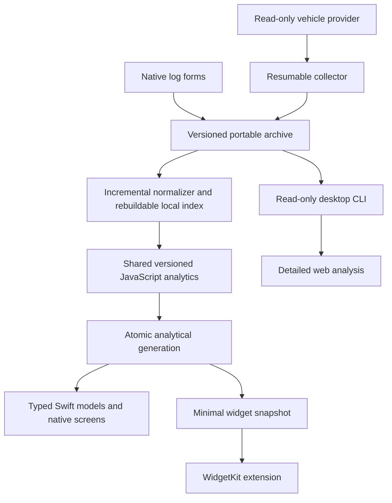

# Car Analytics v2 product and engineering plan

Status: proposal for implementation. Scope: an iPhone-first personal car performance application, retaining the existing archive and desktop analysis. All numerical examples below are invented; targets are proposed acceptance criteria, not measured results.

## 1. Product direction

Build a personal vehicle engineering notebook: understand changes, separate operating conditions from driving behaviour, maintain the car, and test small improvements. The everyday app should be useful in ten seconds; the engineering tools should support a serious investigation without overwhelming that first screen.

The central interaction is **observation → comparison → explanation → action → follow-up**. A card saying “economy fell” is incomplete. It should show the period, comparable baseline, uncertainty, coverage, plausible contributors and a route into the underlying trips. Never imply that a road car has F1 telemetry when the source supplies delayed summaries and coarse GPS.

The recommended approach is an incremental native redesign. Preserve the collector, archive protection and shared analytics, while replacing the main web dashboard with SwiftUI screens. Retain the web analysis as an optional detailed workspace and desktop companion. A simultaneous rewrite of collection, storage, models and presentation would make discrepancies difficult to diagnose.

## 2. What exists today

| Layer | Current implementation | Assessment |
|---|---|---|
| iPhone shell | SwiftUI tabs for Dashboard, Log, Settings | Native lifecycle and forms exist; the analytical experience has a second navigation system inside Dashboard |
| Dashboard | WKWebView serving four HTML pages through a custom scheme | Rich, reusable charts; desktop narrative and navigation dominate on a phone |
| Analytics | Shared JavaScript executed by Node or JavaScriptCore | Valuable reusable core; deterministic clustering and a Python comparison harness already exist |
| Collection | Swift Bluelink client and collector; frozen Python reference | Read-only collection, retries, historical finality rules and raw-response preservation are strong foundations |
| Storage | User-selected archive folder, versioned per-entry JSON and photos | Portable and inspectable; cloud file availability, conflict handling and full scans need attention |
| Logging | Native refuel, service and maintenance forms | Offline entry, explicit tank state, photos and station suggestions should carry forward |
| Desktop | Local Python server invoking the same JS CLI | Useful read-only analysis companion; no second writer is needed |
| Testing | JS, Swift core, app, UI and Python tests | Broad intent, but some regressions rely on private archives; public reproducibility needs synthetic equivalents |

Source map: `ios/App/I20LogbookApp.swift`, `ios/App/Dashboard/`, `ios/App/Sync/`, `ios/I20Core/Sources/I20Core/`, `analytics/src/`, `web/`, `serve.py`, and `docs/entry-schemas.md`.

### Existing analytical capability

- Distance, moving time, idle time, trip and event summaries, calendar views and usage trends.
- Route exploration, inferred places, recurring journeys and congestion hotspots.
- Refuel reconciliation, full-to-full intervals, per-trip odometer correction and a Bayesian city/highway/idle consumption model.
- Modelled tank level, parameter uncertainty and modelled trip fuel costs.
- Trip clustering, PCA, speed distributions, GPS-derived dynamics, journey-duration modelling and rank correlations.
- Commute reliability, odometer forecasts, maintenance schedules and logged ownership costs.

These are substantial assets. V2 should improve their validity and discoverability before adding more charts.

## 3. Findings that should shape the redesign

### 3.1 Mobile interaction

`web/styles.css` gives the hero nearly a full viewport with a 560-point minimum, large section padding, a 900-pixel calendar minimum and charts commonly 300–440 pixels high. Responsive grid collapse helps, but it leaves a long report. The native tab bar plus web page navigation creates two hierarchies. Hover-oriented charts, dense method text, tables and repeated map interactions need deliberate touch alternatives.

Replace the initial hero with a compact briefing. Show one meaningful chart per card, one primary action per screen, and methods on demand. Maps should support a trip investigation rather than consume the opening screen. Long-press exploration must have a tappable alternative. Preserve state when moving between a trip and a comparison.

### 3.2 Measurement and model validity

| Finding | Evidence in current source | Required v2 treatment |
|---|---|---|
| City/highway is a whole-trip classification at a moving-speed threshold | `analytics/src/fuel.js`, `HWY_KMH` and interval construction | Label it a proxy. Use sensitivity checks; support segment splits only when route quality permits |
| Economy above a type-approval constant becomes a missing-fill interval | `intervals()` in `analytics/src/fuel.js` | Use a review flag and multiple consistency checks. A reference test result is not an absolute physical ceiling |
| Legacy full-tank status can be inferred from fill volume | `BRIM_L` and refuel conversion | Preserve unknown state, show inferred labels, let the user confirm; do not silently rewrite history |
| Constant additive distance correction per trip | `calibrate()` in `analytics/src/fuel.js` | Compare constant, proportional and uncorrected models; inspect residuals versus trip length and time; keep raw and corrected values |
| GPS timestamps are spread across gaps before speed/dynamics estimation | `breadcrumbTimes()` and `pointsWithSpeed()` in `analytics/src/tables.js` | Publish sampling quality; reject large gaps and teleports; suppress acceleration precision unsupported by the samples |
| Fuel parameters can be weakly identifiable | Three predictors fitted to full-to-full intervals in `fitModel()` | Show independent interval count, posterior correlation, prior sensitivity and whether a coefficient is primarily prior-driven |
| Leave-one-out uses a noise parameter selected on all intervals | `fitModel()` selects sigma before the LOO loop | Refit tuning inside each validation fold; add chronological evaluation and compare against a simple baseline |
| Tank bands mainly reflect coefficient uncertainty | `tankLevel()` in `analytics/src/fuel.js` | Include fill, gauge, calibration and process uncertainty before presenting bands as predictive range |
| Costs mix modelled fuel over archived distance and logged costs over lifetime odometer | `runningCost()` in `analytics/src/insights.js` | Present separate cash spend, attributed consumption cost and ownership cost over explicit, aligned windows |
| “Cold start” means parked for at least four hours | `COLD_SOAK_H` in `analytics/src/performance.js` | Label as a long-soak proxy; do not imply coolant temperature was measured |
| Forecast assumes independent identically distributed daily distance | `forecast()` in `analytics/src/performance.js` | Backtest a weekday-aware baseline and block bootstrap; show interval calibration and expiry of stale forecasts |
| Overview mutates trips before performance consumes them | `runAll()` ordering in `analytics/src/index.js` | Create an explicit normalized trip enrichment stage and immutable analytical inputs |

Harsh-event counts are provider-defined and depend on exposure. Compare counts per distance or driving hour, with sufficient denominators. Avoid a universal driver score or rankings based on top speed. Correlation, cluster labels and before/after differences are descriptive unless a suitable study design supports a stronger conclusion.

### 3.3 Reliability and scale

`SyncCoordinator.rebuild()` returns while a run is active. A save during a run can therefore request an update that is not scheduled. Add a pending generation counter and rerun once the current generation finishes. A successful collector timestamp must be distinguished from a successfully published analytical snapshot.

`AnalyticsRunner` enumerates all raw and log JSON, schedules placeholder downloads and loads the archive into JavaScriptCore for each rebuild. The synchronous file/JS work has no explicit dedicated worker isolation. Measure UI blocking, memory and archive growth; move work to an isolated worker and use bounded downloads plus incremental normalization.

Individual derived files are written separately. Introduce a generation directory and one atomic manifest switch so Overview, Fuel and Performance always describe the same input revision. A failed generation keeps the previous one. Distinguish incomplete inputs from a legitimately empty result.

`entriesIn()` ignores conflict-copy filenames. That prevents double counting but can hide an edit. Add a conflict inbox with record revisions, explicit resolution and recoverable tombstones. Atomic file replacement alone does not solve cloud concurrency. Cloud synchronization is not a backup.

External map tiles and web fonts remain network dependencies. System fonts should make the native app independent of font downloads. Route geometry and summaries should remain useful without tiles; keep attribution and provider limits when tiles are requested.

## 4. Information architecture

Use four primary destinations, a persistent quick-add action, and Settings behind the vehicle/profile control.

| Destination | Question answered | Main content |
|---|---|---|
| Today | What should I know or do? | Freshness, last trip, compact weekly trends, fuel estimate, next service, one prioritized finding |
| Trips | What happened on that journey? | Searchable timeline, saved journeys, filters, trip detail, route replay and comparison |
| Garage | What does ownership need and cost? | Refuels, service history, maintenance, reminders, cash ledger, documents and fuel detail |
| Lab | Why did performance change? | Matched comparisons, experiments, scenario calculations, model diagnostics and data quality |

Keep date range, vehicle context and filters explicit. A shared trip-detail destination must open from all tabs, widgets and notifications. Deep links must survive an app launch and a temporarily unavailable archive. Start with one vehicle, but put vehicle identity in domain contracts rather than global constants.

### Today wireframe

```text
Vehicle name                Synced 2 h ago • 1 item to review
This week                   distance / elapsed time / estimated fuel cost
[one compact trend with comparison and coverage]
Last drive                  journey • duration • idle share
Fuel                        last measured gauge / modelled range / timestamp
Next attention              service or record requiring review
Engineer’s note             one supported finding → Inspect
[Add refuel]                [Add service or expense]
Today       Trips       Garage       Lab
```

The ordering is adaptive within limits: a sync failure, low-confidence estimate or overdue item can move above the weekly trend. Never invent a reassuring “all good” status when the vehicle data is stale.

## 5. Design system

Retain the current navy, amber and blue identity. Use restrained instrument-panel cues: precise typography, readable units, compact sparklines, meaningful deltas and consistent scales. Avoid ornamental gauges when a labelled number and range are clearer. Support both dark and light appearances.

- Start with a 4/8-point spacing system, 16-point screen margins and content-driven card heights. Use tabular numerals for measurements and system text styles for Dynamic Type.
- Provide at least 44-by-44-point interactive areas, native back gestures, safe-area layouts and reachable primary actions. Validate the smallest supported phone as well as a typical device and landscape.
- Each metric has a title, value, unit, observation period, comparison, quality and source. Put detailed methodology behind an accessible “How calculated” action.
- Use blue for a comparison series, amber for attention or selection, and labelled red for problems. Improvement direction depends on the metric; falling speed is not automatically bad.
- Show uncertainty as a range or band with its meaning. Unknown values are “Unavailable” with a reason, never zero.
- Give every chart a short textual interpretation and an accessible data table. Support VoiceOver, large text, Reduce Motion, increased contrast and non-colour cues.
- Keep common cards to one chart and approximately three headline metrics. Offer 7/30/90-day ranges plus a custom range; keep units and baseline visible.
- Save scroll position, selected trip and comparison filters. Use haptics for committed actions, with undo for deletion and explicit error recovery.

Prototype Today, trip detail, comparison, refuel, and empty/error states before implementing the whole navigation. Review a real-device refuel task with one hand and the keyboard visible.

## 6. Widgets and quick actions

In-app cards and Home/Lock Screen widgets are separate deliverables. Ship useful in-app cards first; add WidgetKit after app-group sharing and signing have been proven for the selected distribution route.

| Widget | Content | Interaction and limits |
|---|---|---|
| Vehicle glance, small | Most recent odometer or fuel estimate, update time | Opens Today; no implied live telemetry |
| Weekly efficiency, medium | Week distance, idle share, comparable trend | Opens the exact period; hide estimate when evidence is inadequate |
| Next service, small/medium | Earliest distance/date due item and confidence | Opens maintenance; due date is estimated when usage-based |
| Quick refuel | Add-refuel shortcut with last station suggestion only if enabled | Opens the native form; never commits an assumed fill |
| Archive health | Last successful archival date and records needing review | Opens Data Quality; useful for preventing collection gaps |
| Lock Screen | Minimal service countdown or sync age | No locations, registration or spend by default |

Write an atomic, minimal widget snapshot after a successful analytical generation. Widgets read this snapshot rather than the cloud archive, tokens or full database. Default to a privacy-safe display; require opt-in for financial figures, routes or locations. Store a schema, generation ID and updated-at value in the snapshot. Show stale status when appropriate.

Widget updates are scheduled and budgeted by the system; do not promise exact refresh intervals or continuous vehicle status. See [Apple’s widget update documentation](https://developer.apple.com/documentation/widgetkit/keeping-a-widget-up-to-date). Background collection is opportunistic; foreground sync and archive-risk reminders remain necessary. See [Apple’s background strategy guidance](https://developer.apple.com/documentation/backgroundtasks/choosing-background-strategies-for-your-app).

Do not start a Live Activity for ordinary delayed trip summaries. Reconsider only if a future, consented data source provides reliable updates during a suitable activity.

## 7. Engineering tools

### 7.1 Trip debrief and comparable journeys

Trip detail should have Summary, Route and Compare views. Show raw distance, corrected distance where applicable, moving and elapsed time, idle fraction, event rates, estimated cost and route coverage. Scrubbing the route and time profile selects the same point; gaps break the line. Never interpolate a teleport into a plausible journey.

A comparison first matches origin/destination direction, approximate route, departure window, weekday, distance and available operating conditions. Display cohort size and exclusions. Distinguish traffic conditions from controllable behaviour; if weather or AC usage was not measured, list it as unobserved rather than guessing.

Start with saved journeys and robust median/IQR baselines. Require an initial minimum of ten matched trips spanning at least three dates for a directional card; treat this as a usability guard, not statistical proof. Suppress a result when overlap is poor or estimated intervals are too wide. Use blocked resampling by day where feasible, and show observed rather than causal wording.

### 7.2 Fuel engineering

Separate three layers: full-to-full observed economy, modelled fuel attribution, and the provider’s last gauge/range snapshot. A useful fuel card says which one it represents.

Add an interval reconciliation editor: identify unknown fills, distinguish partial/full/unknown, retain the user’s entered values, and show which intervals are excluded and why. Keep a change history. Do not promote a high-volume partial fill into a full fill.

Model diagnostics should show actual versus predicted litres, residuals by time and journey mix, parameter correlation, interval count, prior sensitivity, validation error and baseline error. Prefer constrained positive coefficients or a positive parameterization if needed; mark extrapolation beyond the supported operating range. An unidentifiable idle coefficient should not produce a precise idle-savings claim.

Range forecasts require uncertainty from fuel level, consumption and route mix. Present a conservative planning range and timestamp; never treat it as a guarantee that a route is reachable.

### 7.3 Scenario calculator

Let the user change weekly distance, city/highway proxy mix, idling minutes, fuel price and trip consolidation. Show estimated fuel, cost and travel-time implications with assumptions pinned alongside the result. Highlight inputs outside the training range. A scenario is a calculation, not a measured saving.

First useful scenario: “What if weekly idle time were lower?” Separate unavoidable traffic idling from a user-adjustable assumption. Never recommend unsafe engine shutdown or distracted interaction.

### 7.4 Experiments notebook

Record a hypothesis, primary outcome, eligible trips, baseline window, intervention date, follow-up window, minimum useful effect and possible confounders. Suitable examples are departure-time changes and route choices. Tyre pressure must remain within manufacturer guidance; do not invite arbitrary tuning.

Start with descriptive matched before/after summaries and intervals. Alternating comparable conditions may improve evidence where practical. Track exclusions, missing data, seasonal effects and regression to the mean. Let an experiment conclude “inconclusive.” Fuel-brand comparisons cannot establish a causal fuel benefit from uncontrolled fill history.

### 7.5 Maintenance and ownership

A Garage timeline combines refuels, services, expenses and documents. Add category budgets, insurance and inspection reminders, recurring costs, per-component last-confirmed replacement, and cost summaries with explicit windows. Distinguish scheduled, predicted and confirmed work. A service should reset only components actually marked as replaced.

Show cash spend for budgeting separately from consumed-fuel estimates. Add depreciation and financing only as optional user-entered assumptions. Receipt OCR is a later assistive feature: extraction proposes values, a person confirms them, and the original document stays linked.

### 7.6 Data Quality and internal tools

- Coverage calendar: expected, collected, final, unavailable, malformed and pending-download days.
- Route coverage: retained routes, point counts, timestamp resolution, longest gaps and quality flags.
- Sync inspector: stage durations, resumable checkpoints, retryable failures, fetch age and analytical generation age.
- Record review: missed/duplicate fills, odometer jumps, impossible coordinates, conflict copies and unsupported schema versions.
- Model workbench: version, parameters, validation windows, calibration and comparison against simple baselines.
- Archive tools: manifest/checksum verification, export/import dry run and restore rehearsal.
- Diagnostic export: default to counts, software versions and redacted error classes; preview before export. No raw API responses, credentials, personal folder paths or location traces by default.

## 8. Data feasibility

| Feasible from current source | Feasible as an estimate or proxy | Requires new data or hardware |
|---|---|---|
| Trip distance/time, idle totals, provider event counts | Trip fuel and cost, city/highway mix | RPM, throttle, brake pressure and gear |
| Logged refuels, invoices and expenses | Congestion hotspots and GPS-derived speed | Actual instantaneous fuel flow and coolant temperature |
| Last reported vehicle snapshots | Long-soak starts, service arrival dates | Reliable high-frequency acceleration or 0–100 testing |
| Archived route points where retained | Journey matching and consumption scenarios | Tyre pressure unless an available source is verified |

Do not promise CAN-bus telemetry, engine diagnostics, true track sectors, live traffic prediction or battery state-of-health from the existing feed. An optional OBD-II adapter belongs in a separate later investigation: confirm supported PIDs, sampling rate, background behaviour, power consumption and device security first. It must not delay the useful v2 release.

The repository describes GPS retention of roughly three months based on previous observations. Treat that as an empirical risk, not a provider guarantee. Surface archival age and preserve routes early; retries cannot recover data already purged upstream.

## 9. Architecture and migration



### Contracts and state

Keep the portable folder as the authoritative record, with the existing no-silent-local-only-save behaviour. A local SQLite index is a rebuildable cache. Before adding conflict resolution or queued offline writes, design their acknowledgement semantics explicitly; changing the source-of-truth rule needs an intentional product decision.

Introduce typed domain records for Vehicle, Trip, RouteQuality, Refuel, Service, Expense, SyncRun, Insight and Experiment. Store UTC instants with the source timezone; preserve local calendar dates for user-entered records. The current India calendar semantics must remain stable during migration.

Each computed metric needs: value/unit, period, measured/derived/estimated classification, observation timestamp, input generation, algorithm version, denominator/coverage, quality flags and uncertainty type where available. Unknown is representable separately from zero. Vehicle capacity, reference economy and classification thresholds belong in versioned configuration.

Preserve verbatim raw responses. Add hashes, fetched-at metadata, adapter/schema version and provenance beside the raw content. Normalize incrementally by content hash; refit only models whose inputs changed. Additions to records must remain backward-readable where possible; unsupported schemas go into review rather than disappearing.

Use an actor or equivalent serialized worker for collection and writes, bounded concurrent downloads, explicit cancellation and a queued rebuild marker. Publish all derived artifacts under a generation ID and atomically update one manifest. Widgets and screens select the same complete generation. Keep credentials in device-only Keychain storage and session tokens in memory.

### Native implementation choices

Use SwiftUI navigation, forms and cards. Evaluate [Swift Charts](https://developer.apple.com/documentation/charts) for standard time series, distributions and intervals, and MapKit for native map interactions. Keep a thin, isolated web component only where a complex existing plot would be expensive to reproduce immediately. Measure the bridge rather than rewriting proven mathematics for platform uniformity.

Keep the Node CLI and JavaScriptCore contract testable from synthetic input files. Generate typed Swift decoding models from a documented output schema or validate them against fixtures in both runtimes. A native chart must consume the same metric definition as the desktop chart.

### Migration procedure

1. Freeze a known-good baseline and inventory hashes/counts without exporting personal content into Git.
2. Back up the authoritative folder outside the repository; verify a restore into a temporary test location.
3. Run v2 normalization in read-only shadow mode against the existing archive. No destructive schema rewrite.
4. Compare normalized trips, logs, totals and outputs with the frozen baseline; attribute intentional model differences to versioned changes.
5. Launch a native Today and Trips experience behind a feature flag, with access to the existing dashboard during transition.
6. Add the Garage and Lab tools gradually. Retire the old primary UI only after feature parity and usability checks.
7. Keep downgrade readers, idempotent migrations and an explicit rollback procedure. Never delete old raw data to reduce migration complexity.

## 10. Security, privacy and distribution

The public baseline uses fresh Git history because the previous local history includes private records. Exclude logs, raw/derived car data, invoice images, private CSV/JSON, credentials, signing identities, provisioning material and personal absolute paths. Protocol authorization constants must be supplied locally; synthetic tests must not require them.

Use a secret scanner and a privacy scan before every publication. Check commit author/committer metadata, paths and binaries as well as source text. Ignore rules cannot remove a secret from a prior commit. If a credential ever reaches a remote, revoke it and assess exposure before considering history cleanup.

Make location-aware exports opt-in. Provide home/work masking, map preview and a clear statement that coordinate rounding alone does not anonymize a repeated route. A cropped endpoint may still be identifiable. Do not put sensitive content into widget snapshots, notifications, crash reports or analytics by default.

Keep collection read-only. Do not add remote lock/climate commands as part of this redesign. Preserve user-picked folder boundaries and symlink protections. Add application privacy disclosures appropriate to any eventual distribution and any third-party services actually used.

The existing build assumes local development signing and contains reinstall-expiry UI. V2 should decide distribution early. Prototype app-group widget sharing on a simulator first, then validate entitlements and provisioning on the chosen physical-device route. The release plan must account for current account capabilities and any costs before promising widgets or unattended archival. Paid distribution is a product choice, not an implicit prerequisite for starting the native redesign.

## 11. Roadmap and acceptance gates

Effort estimates are engineering weeks for one experienced developer, including focused testing; calendar duration depends on design review and device/API access. Work is gated by evidence, not dates. A useful native beta is approximately 8–12 weeks; the broader engineering suite is approximately 16–24 weeks total.

| Phase | Effort | Deliverables | Exit criteria |
|---|---|---|---|
| 0: Preserve and reproduce | 1 week | Sanitized repository, CI, synthetic data, baseline metrics, restore rehearsal | Fresh checkout runs public tests; no personal fixtures; source hashes retained privately |
| 1: Design and contracts | 1–2 weeks | Five-screen prototype, metric contracts, domain model, signing/widget spike | One-handed refuel flow and small-phone navigation reviewed; source-of-truth rules documented |
| 2: Reliable data spine | 2–3 weeks | Worker isolation, rebuild queue, generations, coverage index, bounded sync | Edits during sync appear in the next generation; failed rebuild retains old output; memory/UI budgets measured |
| 3: Native daily app | 3–4 weeks | Today, Trips, Garage essentials, native forms, filtering and accessible detail | Core daily workflows usable without web navigation; missing/stale/offline states verified |
| 4: Analytical validity | 2–3 weeks | Fuel reconciliation, corrected validation, diagnostics, aligned cost windows | Chronological evaluation beats or defers to baseline; unsupported precise claims suppressed |
| 5: Lab and widgets | 3–4 weeks | Matched comparison, scenarios, experiments, widget snapshots and deep links | Cohort support/uncertainty visible; widgets stale safely; scenario assumptions explicit |
| 6: Release hardening | 2–3 weeks | Accessibility, performance, migrations, exports, crash recovery, distribution | Restore/downgrade drills pass; release checks and device acceptance pass |

Prioritize native daily utility and trust. OCR, OBD-II, multi-car UI, external weather enrichment, complex route optimization and conversational assistants are later candidates. An assistant, if added, should query computed metrics with provenance; it should not estimate numbers from prose or upload raw location history by default.

### First ten implementation tickets

1. Add a deterministic, comprehensive synthetic archive and CI for Node, Swift core and desktop tooling.
2. Define metric provenance, quality flags, null semantics and output schema; add cross-runtime decoding checks.
3. Fix save-during-sync invalidation with a queued generation counter and a regression test.
4. Move normalization/JS evaluation off the UI actor, bound downloads and publish a generation manifest.
5. Build coverage and sync-health summaries from existing archive metadata.
6. Prototype the native Today card system, navigation, typography and five essential states.
7. Build native Trip list/detail with filtering, preserved selection and measured/estimated badges.
8. Build refuel interval reconciliation and explicit cash-versus-consumption cost summaries.
9. Add fair journey comparisons with cohort counts and uncertainty; validate on synthetic known effects.
10. Prove widget snapshot sharing, stale display, privacy settings and deep links on the intended device build.

## 12. Validation and success criteria

### Data and analytical correctness

Use synthetic archives covering empty history, sparse routes, missing fills, partial/full/unknown tanks, midnight crossings, clock changes, duplicate/conflicting entries, corrupt JSON, schema upgrades, placeholders and provider failures. Add known-effect datasets and out-of-order arrivals. Keep private oracle tests optional, with explicit skips when private data is absent; they must not be described as public coverage.

Check conservation and reconciliation: fuel within an interval sums consistently, normalized distance retains raw provenance, unsupported gaps stay unknown, costs use stated denominators, and no old-generation file appears in a new generation. Restore and migration tests verify checksums and no source mutation.

Evaluate consumption in litres over held-out full-to-full intervals, with nested tuning and chronological windows. Report MAE, bias, baseline comparison and predictive interval coverage. Backtest forecast intervals on rolling origins. Avoid random trip splits that leak neighbouring journeys or a shared refuel interval across train/test.

### Proposed product and performance targets

| Target | Acceptance method |
|---|---|
| Cached Today visible within 1 second at p95 | Instrument repeated cold/warm launches on the agreed oldest supported phone |
| Common refuel logged within 20 seconds | Timed usability task with realistic keyboard and station selection; no prefilled invented odometer |
| No ordinary-task horizontal scrolling at 320–430 point widths | Layout checks across text sizes; analytical tables may open in a dedicated view |
| Smooth scrolling while analysis runs | Instruments and frame-time review; define device-specific budget in phase 1 |
| Incremental recent sync cheaper than full rebuild | Compare elapsed time, peak memory and energy on 1-, 3- and 5-year synthetic archives |
| Zero archive loss or escaped writes | Fault injection, cancellation, placeholder, permission and symlink tests |
| Every estimated headline identifies itself | UI contract tests and accessibility review |
| Core daily workflows work with cached data and no map network | Airplane-mode walkthrough; saves either reach the selected archive or show failure |
| Widgets never imply stale observations are live | Time-travel tests across update delays and failed syncs |

The first usability question is whether the owner can identify one meaningful change and inspect its evidence within thirty seconds. The first engineering question is whether a claimed improvement survives a fair comparison. Both matter more than the count of charts.

## 13. Decisions to revisit before implementation

The plan assumes iPhone remains the primary platform, current local-first ownership rules remain, and desktop remains a read-only companion. Confirm the oldest physical phone, preferred distribution route, whether paid developer capabilities are acceptable, and which daily task is most valuable. These choices affect sequencing, not the ability to establish the baseline or begin native design.

The recommended first release is native Today + Trips + Garage, trustworthy freshness and fuel labels, and a compact comparison tool. The distinguishing long-term feature is an engineering Lab that can explain its assumptions and say when the available data cannot answer a question.
